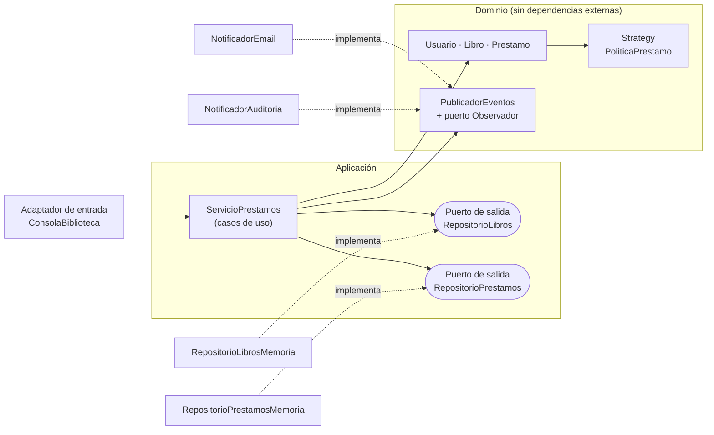

# Taller supletorio · Caso A · Jamerson Barragán Manios

Módulo de **préstamos de biblioteca** refactorizado desde el código espagueti de `original/prestamos.js`.
Lenguaje: **Python 3.9+** (solo librería estándar, sin dependencias). Arquitectura: **Hexagonal**.

## Cómo ejecutar

```bash
git clone https://github.com/<tu-usuario>/taller-supletorio-arquitectura-tunombre.git
cd taller-supletorio-arquitectura-tunombre

python main.py                                  # menú interactivo en consola
python main.py --demo                           # recorrido automático (préstamos, errores, multas)
python main.py --informe-ia                     # imprime informe_uso_ia()
python -m unittest discover -s tests -t . -v    # 18 pruebas
```

No necesita instalar nada ni base de datos: el repositorio es en memoria.

---

## Parte 1 · Principios

Las líneas son las de `original/prestamos.js`.

| Principio violado | Líneas originales | Qué pasa hoy (consecuencia concreta) | Cómo lo resolví |
|---|---|---|---|
| **SRP** (una sola razón para cambiar) | 6–49 (toda `procesar`) | Una sola función valida, aplica reglas, guarda, manda el email y pinta HTML. Si cambia el texto del correo o la fórmula de la multa, hay que editar la misma función donde vive el préstamo y se puede romper. Tampoco se puede probar la multa sin simular un navegador. | Reglas en `dominio/entidades.py` (`Usuario`, `Libro`, `Prestamo`); orquestación en `aplicacion/servicio_prestamos.py` (`ServicioPrestamos`); email en `adaptadores/salida/notificador_email.py`; pantalla en `adaptadores/entrada/consola.py`. |
| **OCP** (abierto a extensión, cerrado a modificación) | 17–18, 19–22, 37–40 | El tipo de usuario se decide con `if/else` en **tres sitios**. Agregar "egresado" obliga a editar los tres; si se olvida uno, queda inconsistente (hoy un tipo desconocido recibe plazo de 0 días, es decir, vence al instante). | `dominio/politicas.py`: `PoliticaPrestamo` y una clase por tipo. Un tipo nuevo es una clase nueva (ver extensión). |
| **DIP** (depender de abstracciones) | 2–4, 25–26, 27, 28, 44–45 | La lógica depende de arreglos globales, de `console.log` y de `document`. Fuera de un navegador explota, y cambiar a una base de datos implica reescribir la función. | Puertos en `aplicacion/puertos.py` (`RepositorioLibros`, `RepositorioPrestamos`) y `Observador` en `dominio/eventos.py`; implementados por adaptadores en `adaptadores/salida/`. |
| **DRY** (no repetirse) | 8–9 con 30–31 (validaciones copiadas); 11 con 43 (búsqueda del libro copiada) | Si cambia la regla del largo mínimo del nombre hay que acordarse de cambiarla en dos lugares. Ya hoy las dos búsquedas del libro son bucles distintos que podrían diverger. | Validación del usuario en `Usuario.__post_init__`; validación del id en `validar_id_libro`; búsqueda en `ServicioPrestamos._obtener_libro`. Todo existe una sola vez. |
| **KISS** (mantenerlo simple) | 6–7, 29, 32–47 | `procesar(accion, …)` decide con un string `"prestar"`/`"devolver"`; un error de digitación no hace nada y no avisa. Hay hasta 4 niveles de anidación y números mágicos (`86400000`, `8`, `15`, `1000`…). `fechaDevolucion` solo sirve a una de las dos acciones. | Dos métodos separados `prestar` y `devolver`; constante `SEGUNDOS_POR_DIA`; los números viven en cada política. |
| **Acoplamiento** (alto) | 27–28, 44–45 | La lógica está pegada al DOM y al formato del correo. En Node `document` no existe: el préstamo ya quedó guardado (líneas 25–26) y luego la función revienta, dejando datos a medias. | El servicio solo publica un evento (`PrestamoRealizado`, `LibroDevuelto`) y la consola es la única que imprime. Notificar ya no puede romper el préstamo. |
| **Cohesión** (baja) | 2–4 con 26 y 43 | Libros, préstamos y reglas son objetos sueltos y cualquier parte del código cambia `libro.disponible` desde afuera. No hay un dueño de la regla "un libro prestado no se presta". | `Libro.marcar_prestado()` / `marcar_devuelto()` y `Prestamo.cerrar()`: cada entidad cuida sus propias reglas. |

**Otros defectos que encontré** (no cuentan como principio, pero se corrigieron):

- **Línea 12:** si el id del libro no existe, `libro` es `null` y `libro.disponible` lanza un error en vez de un mensaje claro → ahora `LibroNoEncontrado`.
- **Líneas 18–22 y 35–41:** un tipo de usuario desconocido no da error: obtiene límite 3, plazo 0 y multa 0 → ahora `TipoUsuarioDesconocido`.
- **Líneas 46–47:** si se devuelve un libro que el usuario no tiene, no pasa nada y no se avisa → ahora `PrestamoNoEncontrado`.
- **Línea 35:** si `fechaDevolucion` no llega, la multa es `NaN` → ahora toma la fecha actual por defecto.
- **Líneas 15 y 34:** el usuario se identifica solo por nombre (dos "Ana Gómez" se mezclarían). Se **mantuvo** así por fidelidad al enunciado; es una limitación conocida (lo ideal sería un id o documento).

---

## Parte 2 · Patrones de diseño

### Patrón 1 · Strategy

**Problema que resuelve.** El plazo, el límite y la multa cambian según el tipo de usuario. En el original eran tres cadenas `if/else` (líneas 17–22 y 37–40); cada tipo nuevo obligaba a editarlas todas.

**Roles** (nomenclatura de [refactoring.guru](https://refactoring.guru/es/design-patterns/strategy)):

| Rol | Clase | Archivo |
|---|---|---|
| Strategy | `PoliticaPrestamo` | `dominio/politicas.py` |
| Concrete Strategies | `PoliticaEstudiante`, `PoliticaDocente`, `PoliticaExterno` | `dominio/politicas.py` |
| Context | `Usuario` (guarda la política y le delega `fecha_vencimiento`, `multa_por_retraso`, `verificar_puede_prestar`) | `dominio/entidades.py` |
| Client | `Usuario.crear()`, que elige la estrategia con `politica_para(tipo)` | `dominio/entidades.py` / `dominio/politicas.py` |

**SOLID relacionado:** **OCP** (se agregan tipos sin modificar código que ya funciona) y **SRP** (cada política conoce solo sus propias reglas).

### Patrón 2 · Observer

**Problema que resuelve.** Las notificaciones estaban escritas dentro de `procesar` (líneas 27 y 44). Agregar un canal nuevo implicaba editar la función central y, si el envío fallaba, afectaba al préstamo.

**Roles:**

| Rol | Clase | Archivo |
|---|---|---|
| Publisher | `PublicadorEventos` | `dominio/eventos.py` |
| Subscriber | `Observador` | `dominio/eventos.py` |
| Concrete Subscribers | `NotificadorEmail`, `NotificadorAuditoria` | `adaptadores/salida/` |
| Datos del evento | `PrestamoRealizado`, `LibroDevuelto` | `dominio/eventos.py` |
| Client | `construir_servicio()`, que decide quién se suscribe | `composicion.py` |

**SOLID relacionado:** **OCP** (nuevos canales sin tocar el servicio) y **DIP** (el servicio depende del publicador/observador, no de un correo concreto).

### Extensión (sin modificar las clases existentes)

| Extensión | Archivos **nuevos** | Archivos **modificados** | Archivos **que NO se tocaron** |
|---|---|---|---|
| Nuevo tipo de usuario **egresado** (10 días, límite 4, $1.500/día) | `extensiones/egresado.py` | `composicion.py` (1 línea de import: es el lugar de ensamblaje, no una clase de negocio) | `entidades.py`, `politicas.py`, `servicio_prestamos.py`, `consola.py`, los demás adaptadores |
| Nuevo canal de notificación **auditoría** | `adaptadores/salida/notificador_auditoria.py` | `composicion.py` (1 línea `suscribir`) | `eventos.py`, `servicio_prestamos.py`, `notificador_email.py`, `consola.py` |

Las pruebas `test_extension_egresado_sin_modificar_codigo_existente` y `test_canales_nuevos_sin_modificar_el_servicio` lo comprueban. Se pueden ver en acción con `python main.py --demo`.

---

## Parte 3 · Patrón arquitectónico: Hexagonal

### Diagrama



Regla de dependencias: todo apunta hacia adentro. Los adaptadores conocen a la aplicación y al dominio; el dominio no conoce a nadie.

### Estructura de carpetas

```
taller-supletorio-arquitectura-tunombre/
├── README.md
├── INFORME_IA.md
├── main.py                         # arranca la aplicación
├── original/prestamos.js           # punto de partida (espagueti)
├── biblioteca/
│   ├── composicion.py              # ensambla piezas concretas (composition root)
│   ├── dominio/                    # NÚCLEO: sin dependencias externas
│   │   ├── entidades.py            #   Usuario, Libro, Prestamo + sus reglas
│   │   ├── politicas.py            #   Strategy
│   │   ├── eventos.py              #   Observer (eventos, publicador, puerto Observador)
│   │   ├── errores.py              #   errores de negocio con mensajes claros
│   │   └── informe_ia.py           #   informe_uso_ia() (convención del curso)
│   ├── aplicacion/                 # casos de uso y puertos
│   │   ├── puertos.py              #   puertos de salida: interfaces de repositorio
│   │   └── servicio_prestamos.py   #   prestar, devolver, consultar, listar
│   ├── adaptadores/
│   │   ├── entrada/                # quién usa la aplicación
│   │   │   ├── consola.py          #   adaptador de entrada: menú de consola
│   │   │   └── demo.py
│   │   └── salida/                 # lo que la aplicación usa
│   │       ├── repositorio_memoria.py
│   │       ├── notificador_email.py
│   │       └── notificador_auditoria.py
│   └── extensiones/egresado.py     # tipo de usuario añadido sin tocar el núcleo
└── tests/test_biblioteca.py
```

| Elemento del patrón | Dónde está |
|---|---|
| Dominio (entidades y reglas) | `biblioteca/dominio/` |
| Casos de uso (capa de aplicación) | `aplicacion/servicio_prestamos.py` |
| Puerto de salida (interfaz del repositorio) | `aplicacion/puertos.py` |
| Adaptador en memoria | `adaptadores/salida/repositorio_memoria.py` |
| Adaptador de entrada | `adaptadores/entrada/consola.py` |

**Operaciones disponibles:** prestar (crear), consultar libro, devolver (cierre) y listar libros / préstamos. La regla principal ("un libro prestado no se puede volver a prestar") responde con `LibroNoDisponible` y un mensaje claro; el adaptador de entrada solo lo muestra.

### Por qué Hexagonal y no MVC

Elegí Hexagonal por dos atributos de calidad:

- **Testeabilidad.** Como el dominio y los casos de uso no dependen de la consola ni de ninguna base de datos, las 18 pruebas corren en milisegundos con un repositorio en memoria, un reloj falso y un observador espía. En el original era imposible probar una multa sin un navegador.
- **Extensibilidad y portabilidad.** Lo que más cambia en este problema está *afuera* del núcleo: dónde se guardan los datos y por qué canales se avisa. Los puertos y adaptadores modelan justamente eso.

Descarté **MVC** porque está pensado alrededor de una interfaz de usuario (el controlador responde a una vista), pero aquí la variabilidad está en los puertos de salida. Además, en MVC es común que el *modelo* termine mezclando reglas con persistencia, y eso sería volver al problema del código original.

### Si mañana se reemplaza el repositorio en memoria por una base de datos

| Cambia | No cambia |
|---|---|
| Nuevo archivo `adaptadores/salida/repositorio_sqlite.py` (o similar) que implementa `RepositorioLibros` y `RepositorioPrestamos` | Todo `dominio/` |
| `composicion.py`: una línea para construir el repositorio nuevo en lugar del de memoria | Todo `aplicacion/` (servicio y puertos) |
| | `adaptadores/entrada/consola.py`, los notificadores, `extensiones/` y las pruebas del servicio |

---

## Sustentación

Video (5 a 10 minutos): _pega aquí el enlace_

## Uso de herramientas

Ver [INFORME_IA.md](INFORME_IA.md).
